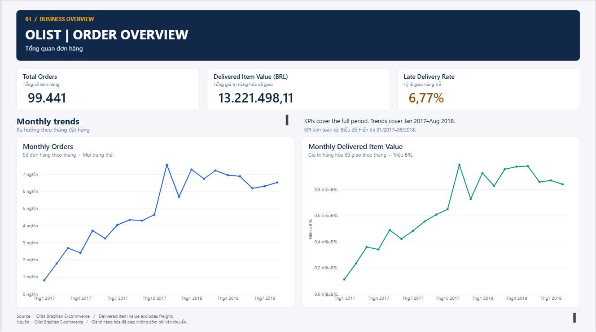
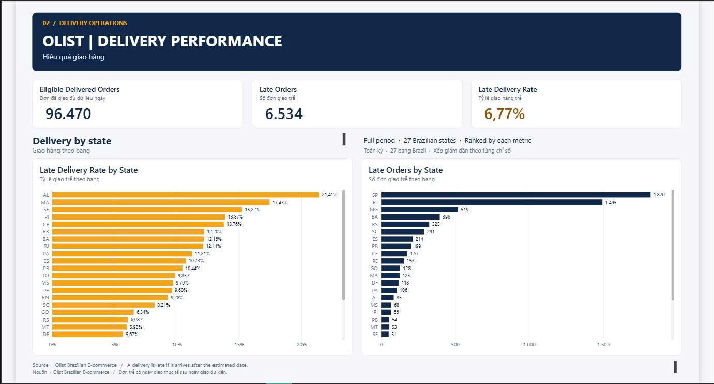

# Olist E-commerce | Order & Delivery Performance Analysis

**SQL Server · Power BI · Data Quality · Business Analysis**  
*A portfolio case study using historical Brazilian e-commerce data.*

## Project overview (Tổng quan dự án)

This project analyzes orders, delivered item value, and delivery reliability using the public **Olist Brazilian E-Commerce Dataset**. The business stakeholder is a **hypothetical e-commerce operations manager**. The goal is to turn transactional records into actionable insights—not to predict future results or claim causation.

The workflow covers **data profiling → data cleaning → SQL analysis → KPI validation → Power BI reporting → operational recommendations**.

**Scope:** 99,441 orders, 112,650 order-item rows, and 99,441 customer records. The order data spans **September 2016–October 2018**. Monthly trend charts focus on **January 2017–August 2018** to avoid sparsely populated boundary months; KPI cards report the full historical period unless a user-applied filter is explicitly indicated.

## Dashboard previews (Ảnh báo cáo)

### Page 1 — Order Overview (Tổng quan đơn hàng)



Tracks the total number of orders, value of items in delivered orders, and late-delivery rate, along with monthly trends.

### Page 2 — Delivery Performance (Hiệu quả giao hàng)



Compares late-delivery **rate** and **count** across all 27 Brazilian customer states. These complementary metrics help distinguish high-risk proportions from high-volume operational impact.

> **Reading note:** Default KPI cards cover the full dataset. Monthly trend visuals use the January 2017–August 2018 focus window, while the state comparisons use the full historical period. Do not interpret a filtered subset as an all-time result.

## Business questions (Câu hỏi kinh doanh)

1. How did **order volume** change by purchase month?
2. How did **delivered item value** change by purchase month?
3. What share of eligible delivered orders arrived **after the estimated delivery date**?
4. Which customer states had the highest **late-delivery rates**, and which contributed the most **late orders**?

## Core KPIs (Các chỉ số chính)

| KPI | Historical result | Definition |
|---|---:|---|
| Total Orders | **99,441** | Distinct `order_id`, all order statuses |
| Delivered Item Value | **BRL 13,221,498.11** | Sum of cleaned item `price` for `delivered` orders; freight excluded |
| Eligible Delivered Orders | **96,470** | Delivered orders with both actual and estimated delivery dates |
| Late Orders | **6,534** | Eligible orders received on a later **calendar date** than estimated |
| Late Delivery Rate | **6.77%** | Late Orders ÷ Eligible Delivered Orders |

**Important:** Delivered Item Value is **item value**, not verified accounting revenue, cash receipts, or profit. Late delivery is calculated by comparing **dates**, not hours within the same date.

## Selected findings (Nhận định nổi bật)

- **November 2017** had the highest monthly order volume: **7,544 orders**. Delivered item value that month was **BRL 987,765.37**.
- **AL** had the highest late-delivery rate at **21.41%** (85 late orders / 397 eligible). Its smaller sample size should be considered when prioritizing operational action.
- **SP** had the largest absolute number of late orders, **1,820**, but a relatively low late-delivery rate of **4.49%** (40,494 eligible).
- **RJ** had **1,495** late orders and a **12.11%** rate (12,350 eligible), making it a meaningful region for further investigation.
- **RJ, BA, and CE** are reasonable priorities for follow-up because their late-delivery rates exceeded the overall **6.77%** while also showing notable delayed-order volumes. This is an **investigation priority**, not a proven explanation for delays.

For supporting calculations, caveats, and recommendations, see [`docs/insights_recommendations.md`](docs/insights_recommendations.md).

## Data cleaning and quality (Làm sạch và chất lượng dữ liệu)

The analysis identified and documented the following:

- **Monetary import scaling:** In the project's SQL Server import, `price` and `freight_value` were **100×** the original CSV amounts. A dedicated SQL view, `dbo.v_olist_order_items_clean`, corrects the locally imported values **without changing the source CSV**. Totals were reconciled independently with the source CSV at the row-count and aggregate level. **This correction is specific to that import; it must not be applied blindly to correctly imported data.**
- **Missing item rows:** 775 orders have no corresponding order-item record. They are retained in the orders dataset; full order counts must not be computed by naively counting joined rows.
- **Missing delivery dates:** Eight `delivered` orders lack an actual delivery date and are excluded from the late-delivery denominator, but not deleted from the data.
- **Timeline anomalies:** 23 orders have an actual-customer-delivery timestamp earlier than their carrier-handoff timestamp. These were documented, not silently rewritten.

Aggregate data checks and SQL–Power BI reconciliation are recorded in [`docs/data_quality_report.md`](docs/data_quality_report.md) and [`docs/validation_report.md`](docs/validation_report.md). The project does **not** claim that every source record was individually reconciled.

## Data model and tools (Mô hình dữ liệu và công cụ)

**Data tables:**

| Object | Grain (Mức chi tiết) | Join |
|---|---|---|
| `olist_orders` | One row per order | `order_id`, `customer_id` |
| `olist_customers` | One customer record per order in this dataset | `customer_id` |
| `v_olist_order_items_clean` | One item line per order-item ID | `order_id` |

`olist_orders` → cleaned items is **one-to-many**; customers ↔ orders is **one-to-one** in this dataset. `customer_id` is an order-associated customer key, **not** a reliable repeat-buyer ID; `customer_unique_id` would be needed for that analysis.

**Tools:** Microsoft SQL Server 2022 Express, SQL Server Management Studio (SSMS), Power BI Desktop (Import mode), SQL, DAX, and Markdown.

## Repository contents (Cấu trúc thư mục)

```text
Ecommerce-Olist-Analysis/
├── README.md
├── .gitignore
├── docs/
│   ├── project_brief.md
│   ├── data_sources.md
│   ├── data_dictionary.md
│   ├── kpi_dictionary.md
│   ├── data_quality_report.md
│   ├── validation_report.md
│   └── insights_recommendations.md
├── sql/
│   └── olist_analysis.sql
├── powerbi/
│   └── olist_dashboard.pbix
├── images/
│   ├── dashboard_overview.png
│   └── dashboard_delivery.png
└── data/
    └── raw/           # local only; CSVs are intentionally not uploaded
```

## How to explore the project (Cách xem và chạy)

**To view the completed report:** Open [`powerbi/olist_dashboard.pbix`](powerbi/olist_dashboard.pbix) using Power BI Desktop. The file was created in **Import mode**; a later refresh may require an accessible SQL Server source and appropriate credentials.

**To inspect the analysis:** Read [`sql/olist_analysis.sql`](sql/olist_analysis.sql) and the documentation in [`docs/`](docs/). The SQL script assumes the `olist_ecommerce` database and its three source tables have already been created/imported; **it is not a complete one-click database setup script**.

**To reproduce from original data:**

1. Download the three source CSVs from the original [Olist dataset on Kaggle](https://www.kaggle.com/datasets/olistbr/brazilian-ecommerce): orders, order items, and customers.
2. Create a local `olist_ecommerce` SQL Server database and import those CSVs into `dbo.olist_orders`, `dbo.olist_order_items`, and `dbo.olist_customers`, with suitable column types.
3. **Check monetary values against the source CSV before running the cleaning view.** The included view divides by 100 because of the documented scaling problem in this project's original import. Adjust the import process instead if your values are already correct.
4. Run and inspect the relevant sections of `sql/olist_analysis.sql`; cross-check against `docs/validation_report.md`.
5. Open the PBIX for the designed dashboard. Refreshing against a separate SQL Server instance may require updating connection settings and revalidating results.

## Limitations (Giới hạn phân tích)

- Historical data from 2016–2018 does not describe current Olist operations.
- There is no verified causal model for delivery delays; state-level comparisons identify areas to **investigate**, not proven root causes.
- The project does not analyze profit, payment settlement, product reviews, or predictive fraud models.
- Aggregate reconciliation and recorded KPI checks do not imply exhaustive record-level or independent Power BI interaction testing.

## Source and attribution (Nguồn dữ liệu)

**Olist — Brazilian E-Commerce Public Dataset**, published on Kaggle:  
https://www.kaggle.com/datasets/olistbr/brazilian-ecommerce

Source CSVs are **not redistributed in this GitHub repository**. Please review the dataset's licensing and terms on Kaggle before reuse.

---

*Portfolio project | SQL analysis, quality assurance, business interpretation, and Power BI reporting.*
