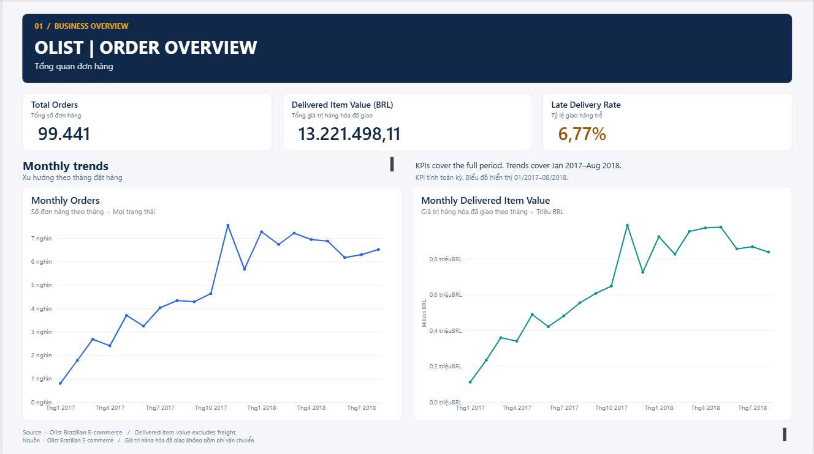
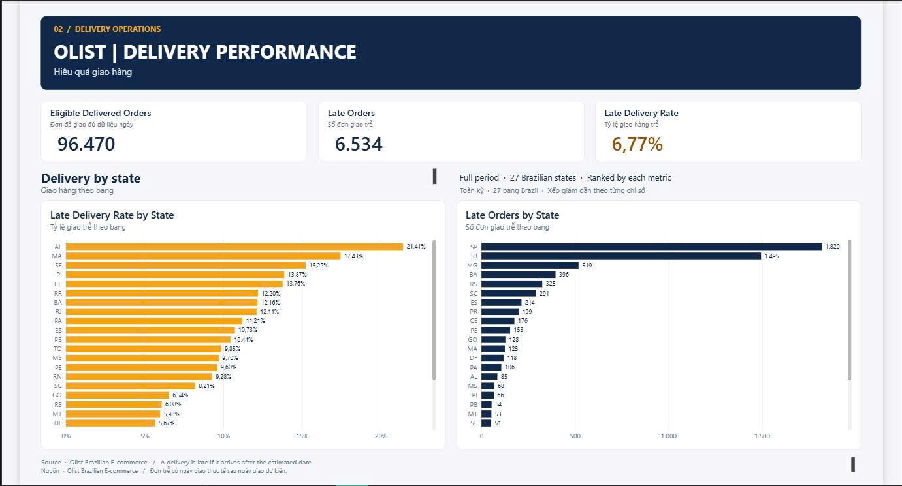

**Ngôn ngữ:** [English](README.md) | Tiếng Việt

# Phân tích đơn hàng và hiệu quả giao hàng của Olist

**SQL Server · Power BI · Chất lượng dữ liệu · Phân tích nghiệp vụ**

Bài phân tích đưa vào hồ sơ năng lực, sử dụng dữ liệu thương mại điện tử lịch sử của Brazil.

## Tổng quan dự án

Dự án sử dụng bộ dữ liệu công khai Olist Brazilian E-Commerce Dataset để phân tích số lượng đơn hàng, giá trị hàng hóa trong các đơn đã giao và mức độ đúng hẹn khi giao hàng. Người đọc giả định là quản lý vận hành thương mại điện tử. Phân tích mô tả các xu hướng trong quá khứ và xác định những vấn đề cần tìm hiểu thêm. Dự báo và phân tích quan hệ nhân quả nằm ngoài phạm vi dự án.

Quy trình gồm khảo sát dữ liệu, làm sạch dữ liệu, phân tích bằng SQL, kiểm tra KPI, lập báo cáo Power BI và đề xuất hướng xử lý cho bộ phận vận hành.

**Phạm vi:** 99,441 đơn hàng, 112,650 dòng sản phẩm trong đơn hàng và 99,441 bản ghi khách hàng. Dữ liệu đơn hàng trải từ **tháng 9/2016 đến tháng 10/2018**. Biểu đồ xu hướng theo tháng tập trung vào **tháng 1/2017 đến tháng 8/2018** để loại các tháng có ít dữ liệu ở đầu và cuối kỳ. Các thẻ KPI dùng toàn bộ giai đoạn lịch sử, trừ khi báo cáo thể hiện bộ lọc do người dùng áp dụng.

## Ảnh xem trước báo cáo

### Trang 1 — Tổng quan đơn hàng



Hiển thị tổng số đơn hàng, giá trị hàng hóa trong các đơn đã giao, tỷ lệ giao trễ và xu hướng theo tháng.

### Trang 2 — Hiệu quả giao hàng



So sánh **tỷ lệ** và **số đơn** giao trễ theo toàn bộ 27 mã bang tại Brazil trong dữ liệu địa chỉ khách hàng. Tỷ lệ cho biết nơi có tỷ trọng giao trễ cao hơn. Số đơn cho biết nơi có nhiều đơn bị ảnh hưởng hơn.

> **Lưu ý khi đọc báo cáo:** Các thẻ KPI mặc định dùng toàn bộ bộ dữ liệu. Biểu đồ xu hướng theo tháng dùng giai đoạn từ tháng 1/2017 đến tháng 8/2018. So sánh theo bang dùng toàn bộ giai đoạn lịch sử. Khi áp dụng bộ lọc, hãy đọc kết quả trong phạm vi đã chọn.

## Câu hỏi kinh doanh

1. **Số lượng đơn hàng** thay đổi như thế nào theo tháng đặt hàng?
2. **Giá trị hàng hóa trong các đơn đã giao** thay đổi như thế nào theo tháng đặt hàng?
3. Trong các đơn đã giao đủ điều kiện, bao nhiêu phần trăm đến **sau ngày giao dự kiến**?
4. Bang nào có **tỷ lệ giao trễ** cao nhất? Bang nào có nhiều **đơn giao trễ** nhất?

## Các chỉ số chính

| KPI | Kết quả lịch sử | Định nghĩa |
| --- | ---: | --- |
| Tổng số đơn hàng | **99,441** | Đếm số giá trị `order_id` khác nhau ở tất cả trạng thái đơn hàng |
| Giá trị hàng hóa trong các đơn đã giao | **BRL 13,221,498.11** | Tổng `price` sau khi làm sạch của các dòng sản phẩm thuộc đơn có trạng thái `delivered`, chưa bao gồm phí vận chuyển |
| Số đơn đã giao đủ điều kiện | **96,470** | Đơn đã giao có cả ngày giao thực tế và ngày giao dự kiến |
| Số đơn giao trễ | **6,534** | Đơn đủ điều kiện có **ngày giao thực tế** sau ngày giao dự kiến |
| Tỷ lệ giao trễ | **6.77%** | Số đơn giao trễ ÷ Số đơn đã giao đủ điều kiện |

**Cách hiểu chỉ số:** Giá trị hàng hóa trong các đơn đã giao chỉ đo giá trị sản phẩm. Doanh thu kế toán đã xác minh, khoản tiền thực thu và lợi nhuận nằm ngoài phạm vi của chỉ số này. Phép tính giao trễ so sánh theo ngày, nên chênh lệch về giờ trong cùng ngày không được tính là trễ.

## Kết quả nổi bật

- **Tháng 11/2017** có nhiều đơn hàng nhất, với **7,544 đơn** và **BRL 987,765.37** giá trị hàng hóa trong các đơn đã giao.
- **AL** có tỷ lệ giao trễ cao nhất, **21.41%** (85 đơn trễ trên 397 đơn đủ điều kiện). Cần cân nhắc cỡ mẫu nhỏ hơn khi xác định thứ tự ưu tiên.
- **SP** có nhiều đơn giao trễ nhất (**1,820 đơn**) và tỷ lệ giao trễ tương đối thấp, **4.49%** (40,494 đơn đủ điều kiện).
- **RJ** có **1,495** đơn giao trễ, với tỷ lệ **12.11%** (12,350 đơn đủ điều kiện), nên là một địa bàn có thể tìm hiểu thêm.
- **RJ, BA và CE** là các địa bàn có thể ưu tiên tìm hiểu vì tỷ lệ giao trễ cao hơn mức chung **6.77%** và số đơn giao trễ cũng đáng kể. So sánh này giúp xác định nơi cần tìm hiểu. Nguyên nhân giao trễ vẫn chưa được xác minh.

Xem [`docs/insights_recommendations.md`](docs/insights_recommendations.md) để biết các phép tính, lưu ý và đề xuất đi kèm.

## Làm sạch và chất lượng dữ liệu

- **Giá trị tiền tệ khi nhập dữ liệu:** Trong lần nhập dữ liệu vào SQL Server của dự án, `price` và `freight_value` cao gấp **100 lần** so với giá trị trong CSV gốc. SQL View `dbo.v_olist_order_items_clean` hiệu chỉnh các giá trị đã nhập và giữ nguyên CSV nguồn. Số dòng và tổng giá trị được đối chiếu độc lập với CSV nguồn. **Chỉ áp dụng hiệu chỉnh khi lần nhập gặp đúng lỗi sai tỷ lệ đã ghi nhận.**
- **Thiếu dòng sản phẩm:** 775 đơn hàng không có bản ghi sản phẩm tương ứng. Các đơn này vẫn được giữ trong dữ liệu đơn hàng. Để tính tổng số đơn, hãy đếm mã đơn riêng biệt từ bảng đơn hàng vì đếm số dòng sau khi nối bảng có thể cho kết quả sai lệch.
- **Thiếu ngày giao hàng:** 8 đơn có trạng thái `delivered` thiếu ngày giao thực tế. Các đơn vẫn được giữ trong dữ liệu và được loại khỏi mẫu số khi tính tỷ lệ giao trễ.
- **Bất thường về thời gian:** 23 đơn có thời điểm giao thực tế cho khách sớm hơn thời điểm bàn giao cho đơn vị vận chuyển. Phân tích ghi nhận các trường hợp này và giữ nguyên thời điểm trong dữ liệu.

[`docs/data_quality_report.md`](docs/data_quality_report.md) và [`docs/validation_report.md`](docs/validation_report.md) ghi lại các kiểm tra tổng hợp và việc đối chiếu kết quả giữa SQL Server và Power BI. Việc đối chiếu được thực hiện ở cấp tổng hợp.

## Mô hình dữ liệu và công cụ

| Đối tượng | Mức chi tiết | Khóa nối |
| --- | --- | --- |
| `olist_orders` | Một dòng cho mỗi đơn hàng | `order_id`, `customer_id` |
| `olist_customers` | Một bản ghi khách hàng cho mỗi đơn hàng trong bộ dữ liệu này | `customer_id` |
| `v_olist_order_items_clean` | Một dòng sản phẩm cho mỗi mã dòng sản phẩm trong đơn hàng | `order_id` |

Trong bộ dữ liệu này, `olist_orders` có quan hệ **một–nhiều** với các dòng sản phẩm đã làm sạch, còn khách hàng và đơn hàng có quan hệ **một–một**. `customer_id` nhận diện bản ghi khách hàng gắn với một đơn hàng. Để phân tích khách mua nhiều lần, cần dùng `customer_unique_id`.

**Công cụ:** Microsoft SQL Server 2022 Express, SQL Server Management Studio (SSMS), Power BI Desktop (chế độ Import), SQL, DAX và Markdown.

## Cấu trúc thư mục

```text
Ecommerce-Olist-Analysis/
├── README.md
├── README_VI.md
├── .gitignore
├── docs/
│   ├── project_brief.md
│   ├── data_sources.md
│   ├── data_dictionary.md
│   ├── kpi_dictionary.md
│   ├── data_quality_report.md
│   ├── validation_report.md
│   └── insights_recommendations.md
├── sql/
│   └── olist_analysis.sql
├── powerbi/
│   └── olist_dashboard.pbix
├── images/
│   ├── dashboard_overview.png
│   └── dashboard_delivery.png
└── data/
    └── raw/           # chỉ lưu cục bộ; CSV nguồn được giữ ngoài repository
```

## Cách xem và chạy dự án

**Xem báo cáo:** Mở [`powerbi/olist_dashboard.pbix`](powerbi/olist_dashboard.pbix) bằng Power BI Desktop. File sử dụng **chế độ Import**. Khi làm mới dữ liệu, bạn có thể cần kết nối được với nguồn SQL Server và có thông tin xác thực phù hợp.

**Xem phần phân tích:** Đọc [`sql/olist_analysis.sql`](sql/olist_analysis.sql) và tài liệu trong [`docs/`](docs/). Hãy tạo cơ sở dữ liệu `olist_ecommerce` và nhập ba bảng nguồn trước khi chạy tập lệnh. Tạo cơ sở dữ liệu và nhập CSV là các bước thực hiện riêng.

**Chạy lại phân tích từ dữ liệu nguồn:**

1. Tải ba file CSV về đơn hàng, dòng sản phẩm trong đơn và khách hàng từ [bộ dữ liệu Olist trên Kaggle](https://www.kaggle.com/datasets/olistbr/brazilian-ecommerce).
2. Tạo cơ sở dữ liệu `olist_ecommerce` trên SQL Server cục bộ. Nhập các file CSV vào `dbo.olist_orders`, `dbo.olist_order_items` và `dbo.olist_customers` với kiểu dữ liệu cột phù hợp.
3. **Đối chiếu giá trị tiền tệ với CSV nguồn trước khi chạy SQL View làm sạch.** SQL View đi kèm chia giá trị đã nhập cho 100 để sửa lỗi sai tỷ lệ đã ghi nhận. Nếu giá trị đã nhập khớp với CSV, hãy giữ nguyên các giá trị đó và điều chỉnh quy trình để bỏ qua bước hiệu chỉnh.
4. Chạy các phần liên quan trong [`sql/olist_analysis.sql`](sql/olist_analysis.sql) và đối chiếu kết quả với [`docs/validation_report.md`](docs/validation_report.md).
5. Mở file PBIX để xem báo cáo. Nếu làm mới dữ liệu từ một máy chủ SQL Server khác, bạn có thể cần cập nhật cấu hình kết nối và kiểm tra lại kết quả.

## Giới hạn phân tích

- Dữ liệu giai đoạn 2016–2018 phản ánh hoạt động trong quá khứ. Hoạt động hiện tại của Olist nằm ngoài phạm vi phân tích.
- So sánh theo bang giúp xác định nơi cần tìm hiểu thêm. Để xác định nguyên nhân giao trễ, cần thực hiện phân tích nhân quả riêng.
- Lợi nhuận, quyết toán giao dịch thanh toán, đánh giá sản phẩm và mô hình dự báo gian lận nằm ngoài phạm vi dự án.
- Việc kiểm tra bao gồm đối chiếu ở cấp tổng hợp và kiểm tra KPI đã ghi nhận. Kiểm tra toàn bộ ở cấp bản ghi và kiểm thử độc lập các tính năng tương tác trong Power BI nằm ngoài phạm vi của các bước này.

## Nguồn dữ liệu và ghi công

[Olist — Brazilian E-Commerce Public Dataset](https://www.kaggle.com/datasets/olistbr/brazilian-ecommerce), được công bố trên Kaggle.

Các file CSV nguồn được giữ ngoài repository này. Vui lòng xem giấy phép và điều khoản của bộ dữ liệu trên Kaggle trước khi sử dụng lại.

---

*Dự án trong hồ sơ năng lực gồm phân tích bằng SQL, kiểm tra chất lượng dữ liệu, diễn giải kết quả nghiệp vụ và lập báo cáo Power BI.*
